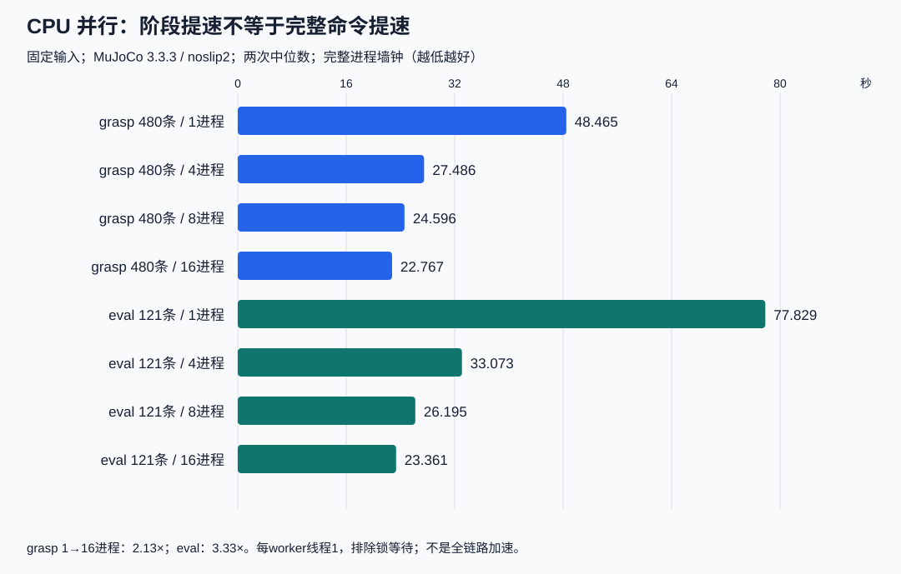
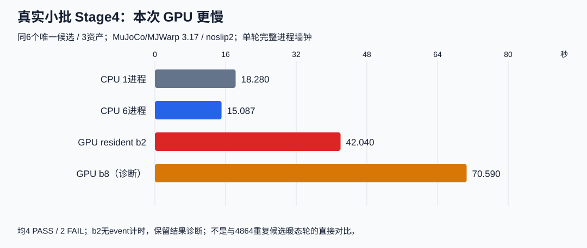
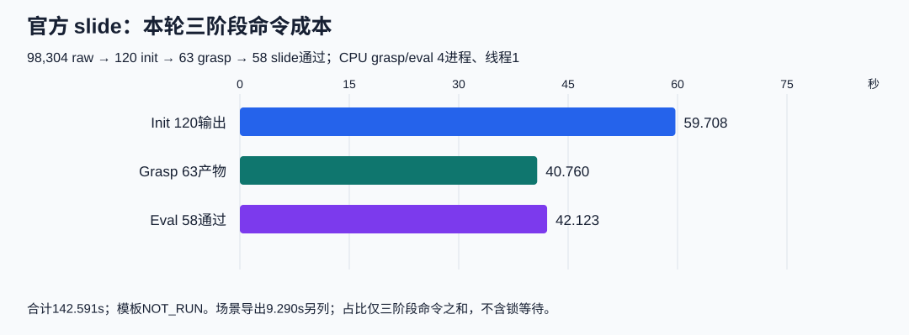

# Dexonomy：三组组会关键结果（2026-11-03）

**目前能支持的是CPU并行收益、GPU在特定大批重复队列上的吞吐，以及官方slide的有界工作流核验；尚不能声称全链路GPU生产加速。** 本报告仅回读已有证据，没有新增实验。

## 1. CPU多进程确实有效，完整命令收益受启动成本限制

固定480条grasp输入与121条eval输入，每档两次、每进程线程1。MuJoCo3.3.3，FC+实体plane，noslip2。

|1→16实际worker|阶段秒|阶段加速|完整命令秒|完整命令加速|
|---|---|---:|---|---:|
|Grasp，480→121|28.328→3.513|8.06×|48.465→22.767|2.13×|
|Eval，121→98|60.668→5.393|11.25×|77.829→23.361|3.33×|

逐轮标签、物理步数和grasp数组已由原worker及总控核对；本次回读小JSON并复算。导入约16–17s，使短批阶段收益在完整命令中被摊薄。16进程尚未测到平台，32+未测；不是全流水线加速，也不是与GPU的公平直接对照。证据T，交付`1a72e96`，总控已接受。

负结果也要保留：另一组固定CPU实验将每候选建模改成按物体复用，构建236→6，但六worker的236次重放从34.803变42.088s，**耗时增加20.93%**。整组负载不均是有诊断支持的解释，不能只报模型构建数减少。证据R，`12cf766`。

## 2. GPU大批暖态吞吐不能代表真实少候选成本

|场景|结果|允许解释|
|---|---|---|
|3.12 / noslip0；19唯一瓶子候选×256=4864尝试；b2048|host45.082s→resident29.471s；165.05尝试/s|同队列暖态轮约1.53×；控制缓存+调度组合收益。预热1+正式3，11/19唯一通过|
|3.17 / noslip2；同19×256；b2048|75.986s；64.01尝试/s；12/19唯一通过|恢复noslip的绝对成本；版本、参数、早退步数变化，不与3.12计算工程加速比|
|正式3.17 / noslip2；3物体各2条真实候选|CPU6完整15.087s；GPU b2完整42.040s|GPU本次为CPU6的2.79倍耗时；单轮，不能外推所有规模|

小批均4PASS/2FAIL，但末态不逐位相同。GPU诊断中3模型构建合计0.366s、上传0.178s、graph准备2.157s、执行loop18.637s；**本例不支持“模型加载主导”**。loop还含控制、判定、同步，不是纯物理内核时间。

两资产合模只有原型证据，模型审计仍REVIEW；缺少cached-single公平对照，不能以合模cached8.436s对single10.014s宣称收益。3.12的4096 graph OOM保留UNKNOWN，8192未测；3.17的4096未运行，不能混称两版本都实测OOM。证据G/V/F；`49a0484`受限原型、`c1cf7e4`受限Stage4已接受，`51679fa`完整历史验收待核。重复4864次不等于4864个新抓取。

## 3. 官方slide已完成六组合核验，失败与分母明确

固定MeshProcess `638d777`官方exporter函数，运行`51718e3`、交付`3989546`。三个物体各两抓型，每组合20 init。

|物体|Tripod：init / grasp / slide通过|Lateral：init / grasp / slide通过|
|---|---|---|
|bottle|20 / 19 / 18|20 / 18 / 18|
|can|20 / 8 / 8|20 / 0 / 0|
|mug|20 / 12 / 11|20 / 6 / 3|

总计 **98,304 raw→120 init→63 grasp→58 slide通过**；57条grasp失败、5条eval失败，物理异常/UNKNOWN为0。58/63=92.1%仅是进入eval后的通过率；相对所有init是58/120=48.3%。罐子Lateral 0/20保留；120 init并不代表全部满足初始化硬条件，最终四条件交集本轮未测。

Init/Grasp/Eval完整命令合计59.708/40.760/42.123s，三阶段占比41.9%/28.6%/29.5%，总142.591s。模板复用，**tmpl NOT_RUN**；场景导出9.290s另列。上一轮扩大FC+plane为95.801/46.679/52.630s，三阶段总195.111s；prepare26.717s混合模板和场景，不能算纯tmpl。两批配置不同，不作速度或成功率优劣对比。

58个通过样本末态物体碰撞底面离桌90.468–101.414mm。语义是浮动Shadow手沿+Z滑移0.1m、关闭全局重力并施加向下质量×9.8外力，阈值5cm/15°。不是机械臂/真实机器人提起，也不是完整官方预处理或多尺度布局复现。先导19条未记录正确qfrc力通道，后续44条已记录；不将早期xfrc=0误写成无外力。旧两轮是FC+实体桌面诊断，不能冒充本轮slide。

## 讨论时保留的边界

已有证据支持优先关注真实“每模型候选数”和启动/准备摊销；下一研究决策应依实际数据分布，而非只看满batch吞吐。尚缺纯模板计时、GPU新候选生产吞吐、缓存单资产公平对照和全链路统一配置基准；本次没有为补齐这些数据重跑。

完整比较矩阵及详细证据映射保留在本地，本分支仅发布精简报告与配套图表。本报告只发布研究汇总，不包含实现代码或原始产物。
